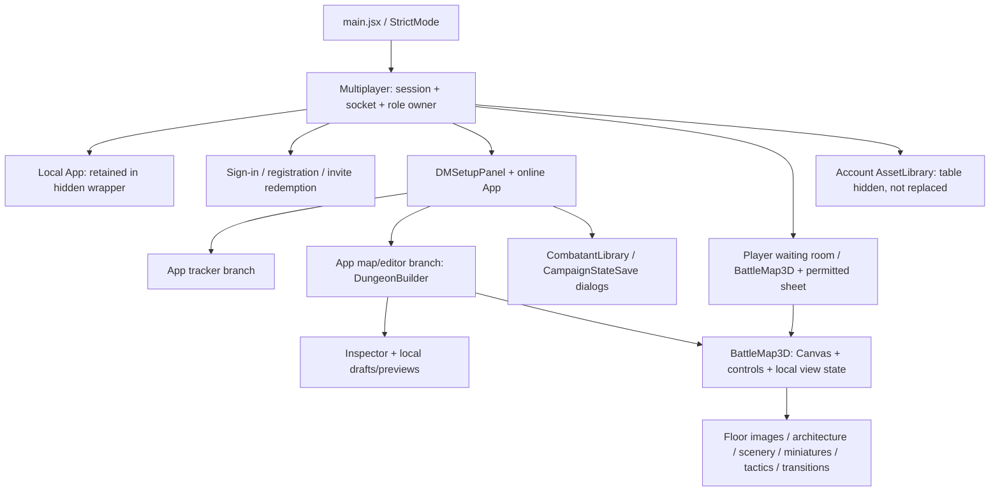

# Encounter Ledger UI audit — Phase 0

**Review date:** 31 October 2026. **Code baseline:** `0a2aedfb1c0b9965665740d20761d8351ce7ee8f`. **Decision status:** recommendations for review, not redesign implementation authorization.

The proposed hierarchy, context-owned actions, quieter canvas docks and grouped inspector are a good direction. Implement them around existing state owners and permission boundaries. Do not copy the mockup DOM/CSS wholesale, invent behaviour to match its labels, or replace the scene with `mapbg.jpg`.

## 1. Scope, method and evidence

Inspected the React entry points and every user-facing component in `src/`, shared command/map schemas, Express and Socket.IO authorization/persistence, all application stylesheets, existing browser/unit/integration test sources, the four supplied HTML/PNG pairs, CSS and both versions of the design document. The [matrix](feature-zone-matrix.md) inventories **175 existing feature/control families** and is the detailed inventory and preservation checklist; repeated per-combatant/per-floor fields are grouped with their complete option families.

References are archived and checksummed as described in [README](README.md). Only a notice and section 12 addendum amend the standalone v2.1 guidelines; its original remains byte-for-byte available. Attached instructions such as “never add a third row” are evaluated as proposals, not applied as coding instructions during this audit.

Runtime observations in [current-baseline](current-baseline/) use synthetic, built-in local-demo combatants, an in-memory blank map and temporary Chromium contexts. External Google fonts were blocked to make captures reproducible; typography is therefore fallback typography. The captured app uses its real React/Three.js renderer, not the proposal. There is no backend or real campaign data in those captures. Role and backend conclusions below are source-backed; screen-reader, touch hardware, Safari/Firefox, browser-native fullscreen and 200% browser zoom remain implementation acceptance checks, not certified results of this audit.

## 2. Existing architecture and navigation

This is a component tree, **not a route map**. There is no React router dependency or frontend `/table`, `/libraries` route implementation. `Multiplayer` uses local `mode`, actor, session/campaign selection and conditional rendering. Invitation links use `#invite=...`; redemption removes that hash with `history.replaceState`. Express has `/api/...` routes and a production SPA fallback. A future A3 “page” can initially be a component-level view. Deep links, browser history and routing are a separate design decision, not justification to add a router in Phase 1.

### State and persistence boundaries

| Owner / evidence | State owned today | Constraint when moving controls |
| --- | --- | --- |
| [Multiplayer.tsx](../../src/Multiplayer.tsx), [sessionBootstrap.ts](../../src/sessionBootstrap.ts) | Actor, CSRF, campaigns, details, invitations, checkpoints, connection status, members, socket, current snapshot/session refs, single in-flight command guard | Keep one session/socket owner. New menus receive existing callbacks. Do not reconnect when a drawer or library opens. Preserve anonymous bootstrap single-flight and registration-closed/invitation flows. |
| [App.jsx](../../src/App.jsx) | Local encounter/map history; online snapshot consumption; selected combatant, tracker/map/editor view, HP amount, condition/add forms, artwork inputs, library picker, pending library instance/encounter ID, campaign-save dialog | Selection is not initiative turn. Pending placement must stay encounter-scoped. Preserve the distinction between online authority and local memory. |
| [DungeonBuilder.tsx](../../src/DungeonBuilder.tsx) | Editing tool/activation, selection per floor, scenery/architecture draft maps, transition draft and endpoint picking, generation preview/options, floor preview, template name/baseline, inspector state, active/local hidden floors | A collapsed accordion/drawer must not destroy its draft owner. Live revisions can invalidate selections/drafts: retain the existing conflict rules, not a blanket “keep every draft forever.” |
| [BattleMap3D.tsx](../../src/BattleMap3D.tsx), [useMapViewport.ts](../../src/useMapViewport.ts) | Camera/OrbitControls, roster expansion, fallback floor-view state for direct player map, tactical UI, expanded/native fullscreen, inspector access, context dismissal | Keep the same Canvas/control instances across panel, dock and fullscreen changes. DM and player map parents are different; a shell cannot assume every map is inside DungeonBuilder. |
| [shared/domain.ts](../../shared/domain.ts), [server/game.ts](../../server/game.ts) | Command validation, actor authorization, combatants, round, active ID, map commands, projections, revisions, receipts | Use the existing `send`/`applyCommand` path. Never introduce an optimistic client-only “authoritative” encounter or bypass command envelopes from a new menu. |
| [server/app.ts](../../server/app.ts), [server/maps.ts](../../server/maps.ts), [server/combatant-library.ts](../../server/combatant-library.ts) | Session/campaign operations and PostgreSQL-backed encounters, map copies/templates, library definitions and explicit campaign state | A campaign is not a live session. A checkpoint, a map template, a library definition and a campaign character state are different save targets. |
| [assetResourceCache.ts](../../src/assetResourceCache.ts), [modelResources.ts](../../src/modelResources.ts), [floorImageResources.ts](../../src/floorImageResources.ts) | Request coalescing, scoped resource leases, independent model clones, disposal/budgets and floor textures | Keep stable asset IDs and existing identity/campaign/encounter scoping in URLs/cache keys. A thumbnail/picker must not create a second loading pipeline or dispose resources still used by a map. |

**Actual mount guarantees:** switching Battle map ↔ Map editor keeps `DungeonBuilder` in the same App branch; folding panels and expanding/fullscreening the map keep its Canvas mounted. Switching App to Tracker currently unmounts DungeonBuilder. The standalone local App is retained while online mode is shown; the account Asset Library hides the table wrapper. Do not claim all view switches already preserve the camera. Extending that guarantee to Tracker or new library routes would require an explicit retained-workspace/lifetime design and resource budget; at minimum the redesign must preserve existing guarantees.

### Backend surface the UI must retain

- Session bootstrap, DM sign-in/optional registration/sign-out, single-use invitation redemption; campaign list/create/rename/details and active-encounter selection.
- Create/import encounter, open encounter, start/end multiplayer session, invite creation/revocation, membership revocation, checkpoints create/list/restore and encounter export including embedded artwork.
- Scoped map-template list/detail/save/overwrite/rename/duplicate/delete; floor-image list/upload/delete/file; GLB asset list/upload/update/delete/file; library list/write/archive/state read. Appearance and state changes use existing commands.
- WebSocket `campaign.join` and `game.command`; campaign state revision orders activation/switches, encounter revision checks edits, command receipts suppress retries. Per-socket projected snapshots can omit unchanged map documents; `mergeMapSnapshot` restores references and rejoins when needed. No new polling of the entire encounter on every menu interaction.
- There is **no encounter-rename endpoint, true pause state, standalone global map-template page, bulk campaign-state save or general public library** in the current implementation.

## 3. Usability findings and visual-reference reconciliation

| ID | Finding and repository evidence | Recommendation / proposed decision |
| --- | --- | --- |
| U01 | App mode nav, DM setup/summary and App header consume successive vertical bands; selected library/model buttons add further content before the map. `ledger:map-open` collapses setup but does not unify ownership. | Adopt A/B grouping incrementally; move one-combatant actions to C2/C3/E1. Keep setup accessible through an E3 composition of existing panels. Do not remove actions before their replacements exist. |
| U02 | Inspector “Saved template/Unsaved template changes” is a comparison with a reusable-template baseline. Online map edits already persist with command acknowledgements. Floor/scenery/architecture/transition drafts have explicit apply/save actions. | Label **encounter sync**, **unapplied draft**, **template saved/changed** separately. “Save map” must name whether it saves a new template or overwrites a selected one. A single generic unsaved pill is misleading. |
| U03 | Tracker roster is encounter-wide; map roster is active-floor filtered. App selection, server active turn and editor object selection are separate. | C1 needs explicit scope/floor badges and selected/active text. A unified visual rail must not silently filter an off-floor active turn or move a selected token on the wrong floor. |
| U04 | Player payloads intentionally use placeholder values for concealed stats (`ac:0`, private HP `0/1`); non-owned actions/details/private notes are omitted. | E1/C3 render only fields the projection permits. Never format placeholders as actual HP/AC/speed; do not copy the DM-only mockup sheet onto a player screen. |
| U05 | `useTacticalTools` supports local ruler/template preview, explicit share/update, unshare, edit ownership, expiry and measurement rules. The mockup says “click two squares” and shows Draw/Clear. Actual ruler is left-drag; there is no freehand draw tool. | Preserve existing gestures and local/shared distinction. Name Clear precisely: cancel local tool, delete selected overlay, clear all shared overlays (DM), erase geometry and clear map history are different operations. |
| U06 | Combatant Library is server-backed and available before an encounter; model picker nests inside its dialog. Saved campaign HP/maximum HP/selected long-term conditions are explicit, per character. | A3 management and B6 selection may share the existing library body, but preserve optional encounter context, return destination, revisions, model defaults and duplicate override. Do not replace explicit state saves with autosave or an unimplemented bulk action. |
| U07 | Current map templates are campaign scoped, locally stored only in standalone mode, and managed inside the editor. The global A3 mockup combines “dungeons & floor images.” | Initially route A3 to existing scoped management or a clearly contextual dialog. Uploaded floor images are a different resource API, not interchangeable template records. A standalone aggregate page is later scope. |
| U08 | `Modal` uses native dialog top layer, portal and event isolation. Other popovers use details/toolbar semantics and browser confirmations; accessible menu primitives do not yet exist. | Reuse Modal. Build a small menu/popover/drawer vocabulary with button triggers, focus restoration and clear modality; avoid mockup `` controls. Do not use decorative styling as a reason to remove native semantics. |
| U09 | CSS is cumulative: broad `header`, `button`, `.tabletop-shell`, `:root` and many later overrides; inspector styles have `!important`. App uses DM Sans/Libre Baskerville plus Georgia in newer UI; concept uses Inter/DejaVu/Georgia and global body width/height. | Extract scoped semantic tokens and normalize controls one surface at a time. Do not import `concept.css` globally: its reset, fixed body dimensions and generic class names collide with live UI. Font changes need a loading/fallback/contrast decision, not an unnecessary new dependency. |
| U10 | Canvas overlays currently compete at fixed pixel offsets (viewport, hints, levels, tactics, transitions, palette, history); small screens and long forms magnify collisions. | D1–D6 is an ownership scheme, not six permanently full-size rectangles. Define collision/overflow priorities, open one contextual surface at a time, and keep pending-placement and validation messages visible without replacing critical errors with disappearing toasts. |
| U11 | Existing keyboard listeners are distributed; editor Escape uses a capture listener, other tools listen globally. Typed-field/modal guards vary. | Inventory before registry migration; resolve Escape priority and current shortcuts first. Do not enable Space/Save/Undo or letter shortcuts just because the mockup prints them. |
| U12 | Some unavailable controls are correctly disabled for disconnection, busy state, missing documents/assets, preview mode or ownership. | Hide unauthorized features, but retain disabled states and explanations for authorized-but-unavailable actions. “Hide, never disable” must not erase useful network/save state. |
| U13 | Destructive actions have mixed safeguards: native confirm for clear/restore/delete template/asset/level/history/revoke; per-token remove and many undoable scene edits are immediate. | Preserve current guards first. E4 replacement should distinguish destructive irreversible actions from reversible erase/delete gestures; a modal per painted square would break editor usability. |
| U14 | Draft sections remount intentionally on object/floor/revision changes; per-floor draft stores restore supported fields. Tracker switching currently drops the builder. | Do not casually change keys or portal between separate trees. Review each lifetime boundary and draft conflict/discard policy before extracting shared panels. |

**Specific destructive-copy issue:** App's Clear confirmation says it removes combatants, but `encounter.clear` returns `emptyEncounter()`, including an empty map/state. The replacement E4 must describe the full scope before the operation is moved; do not silently change the command or remove its current confirmation. This follows matrix T04 and guideline correction R17.

### Functionality absent or incomplete in the mockups

The matrix supplies the exact destinations. In particular, retain authentication/closed registration/invite expiry; waiting/rejoin/revoked/offline/error states; checkpoint restore; DM token ownership/HP sharing/private notes; current/imported artwork and action-use state; stat-block quantity/initiative/side; library archival/import/source update/saved-vs-full/duplicate/tracker-only modes; GLB upload validation/cancel/pagination/calibration/fallback/retry; floor-image upload/progress/calibration/lock/preview/remove/reuse/delete; separate local and player floor visibility; all transition endpoints/direction/cost/model/DM notes/remote-source and occupied-destination overrides; generation preview/accept/cancel; local templates and saved template operations; tactical ownership/sharing/expiry; native fullscreen denial and restore; touch cancellation and pointer capture. A visually empty inspector section is not a complete workflow specification.

### Proposed functions that must not be treated as existing

The tracker image adds Temp HP, condition durations and recharge notation without corresponding dedicated domain state/commands. It depicts a sort control without an implemented reorder mode. “Linked to library” and model-assigned badges are derivable metadata, but not current controls. The blueprint adds Pause/Resume, encounter rename, resend, bulk Save combatants to campaign, live-player preview, a history timeline, `all` floor mode, standalone blank/JSON encounter-combatant creation and account preferences/help pages. The D4 play palette adds freehand Draw and a separate Move mode; the editor adds Image/Link shortcuts and Shift-straight semantics. Some can become shortcuts to existing panels; behavioural additions require a separately approved feature contract. Future fog/LOS/effects/party presets remain reservations, not Phase 1 deliverables.

## 4. Permissions and role recipes

Evidence: [Multiplayer](../../src/Multiplayer.tsx), [domain projection/commands](../../shared/domain.ts), [authorization and execution](../../server/game.ts), [asset grants](../../server/assets.ts), [floor-image grants](../../server/floor-images.ts), [library routes](../../server/combatant-library.ts).

| Recipe | Show / allow | Omit / prohibit |
| --- | --- | --- |
| Anonymous / invitation | A1/A2 appropriate entry, sign-in and optional registration or display-name redemption; errors and closed-registration notice | Campaign contents/libraries before authentication; static mock names must not become account data. |
| Standalone local | Tracker, in-memory encounter commands and JSON round trip, local map/editor/templates and built-in objects, local tactical preview and local encounter overlays; optionally scoped existing media only if already authorized | No claim of persistent online library, uploads, campaign checkpoints or multiplayer presence. Local template storage is real user map data, not a disposable UI preference. |
| DM preparation | Owned campaign creation/rename/select; create/open encounter and map editing without starting live session; account libraries even without an encounter | No suggestion that entering the editor starts/reveals a session. Map editing currently needs a local or active DM encounter context; standalone persistent map editing without any encounter is not implemented. |
| DM live | Existing commands, all owned campaign content, presence/invites/revoke, token assignment/visibility/HP policy, editor/templates, library and explicit character-state save | No bypass of ownership, revisions or asset access checks. A “player preview” is not a server-authorized player session. |
| Player waiting/ended | Campaign context, status, refresh/rejoin, sign-out, permitted member presence; waiting message | No current encounter/map while inactive. Preserve the existing hidden-but-mounted player battlefield on session end; revocation/sign-out must clear access, not retain secret content behind CSS. |
| Player live | Only projected visible floors/geometry/combatants/transitions/scenery, permitted HP/details; own visible token movement; independent camera, visible floor selection, single/stacked view, local overlays and permitted sharing | No DM editor, Add/Next turn, global library management, campaign mutations, model assignment, HP/condition editing, hidden geometry, DM notes, source library IDs or campaign state. |
| Shared tactical overlays | Players may create on visible floors; edit/remove their own, DM may edit/remove any; only DM clears all. Rulers expire after two minutes; durable template overlays persist. Local previews can remain usable while disconnected. | Do not accidentally remove player ruler/template tools when hiding DM editor D4. Do not grant players edits to others' overlays or persisted HP just because an E1 control exists in the mockup. |

Players currently do not have the DM Tracker/Map editor view switcher; they have a map and a separate permitted selected-character sheet. Any future player “Tracker” recipe is a UI-only presentation of **already projected** information, subject to explicit review. A4 can retain help/sign-out for players. Current players can also switch to the independent Local tracker; if A2 is omitted, preserve that switch and return-to-Multiplayer in A4 rather than treating it as a DM-only capability. B4 can show presence but omit invite/revoke/ownership actions. Hide the A3 DM-library menu as well as A2/B5/B6, not just the zones named in the original principle 11.

**Shared versus local controls:** active floor/view mode/local-hidden floor list, camera, roster collapse, selection and fullscreen are local. Combatant movement, floor `playerVisible`, exact-HP sharing, normal grid/labels and feet-per-square are shared commands. Grid over a floor image updates that image's shared setting. Do not persist these shared switches as `ledger.ui.*` preferences or expose them as player camera-only toggles.

## 5. Three.js, canvas and overlay risks

1. **Resize is allowed; recreation is the risk.** React Three Fiber owns renderer sizing. Let the existing canvas resize in place when layout changes, keep positive dimensions and invalidation, then recompute projected hit points. Preserving a stale aspect ratio to avoid resizing is wrong. The existing `ResizeObserver` height calculation depends on the workspace's document top; a new two-row shell can replace that calculation later, not stack a second observer on it.
2. **Preserve the owner subtree.** A/B and library navigation must not key Canvas by view, panel-open, save revision or fullscreen mode. Keep map/editor toggles on the same builder, respect current Tracker unmount behaviour until deliberately redesigned, and retain per-floor selection and supported draft stores.
3. **Keep expanded/native fullscreen separate.** `useMapViewport` expands the existing builder/standalone map in place, records scroll, manages inert siblings, and requests native fullscreen on `document.documentElement`. Native exit does not necessarily restore expanded mode. E4 dialogs portal to `document.body`; moving native fullscreen to the canvas or an inner div can make dialogs inaccessible. Preserve restore, denial/unavailable fallback and local state.
4. **Respect layers and raycasts.** `.battlefield-wrap` is isolated; Drei Html labels can have high depth z-indices; native dialog top layer sits above them. `ToolbarProjection` clamps fixed HTML context controls to live camera/canvas rectangles and invalidates on scroll/resize. Menus/drawers need event isolation, collision handling and no click-through. Inactive stacked levels are filtered out of raycasts; they must stay display-only.
5. **Do not touch rendering for cosmetic consistency.** Preserve `SharedModel3D`, `AssetPreview3D`, normalized/scoped resource leases, skeleton-safe cloning, original textures/materials, instance transforms, placeholder/error/retry paths, server ownership and file grants. No raster scene replacement or replacement GLB loader. Returning from a picker must retain the pending tool/draft and selected asset.
6. **Multi-floor units are not interchangeable.** Grid coordinates are integers for tokens, scenery can be fractional, calibration offsets are in squares, model offsets are renderer units, and level elevation has an existing absolute conversion. Use current schemas/transforms; do not infer positions from screenshot pixels or alter the current five-feet-per-world-unit elevation convention when the ruler's feet-per-square setting changes.
7. **Tests must use actual readiness and camera state.** Current `workspace-helpers` polls for the mounted root/controls/size and projects through the live camera. Its deterministic delayed-root test addresses CI's visible-canvas-before-root race. No fixed sleeps or synthetic initial camera for replacement controls. Count requests and preserve camera identity across folding/fullscreen while allowing responsive aspect updates.

## 6. Responsive review

The proposal's 1600×1000 CSS canvas, fixed A/B/C widths and sample image do not prove fit at 1280, tablet, phone or 200% zoom. Current breakpoints also do not match its three bands:

| Current source | Breakpoints / behaviour | Audit implication |
| --- | --- | --- |
| `styles.css` | 1150 header compaction; 850 tracker/layout changes; 620 horizontal tracker roster, hidden quick stats/round/title, legacy map-roster hiding | Recover essential stats/actions elsewhere before hiding them. Scope selectors so unrelated headers do not change. |
| `multiplayer.css`, `dm-setup.css` | Nav wraps at 760; setup goes 2 columns at 1200, 1 at 760; token table scrolls | A 56px nav cannot be guaranteed on phones. Large preparation/library forms need document or drawer scrolling. |
| `editor-workspace.css` | Inspector 330px then 290 at 1050; overlay below 700; expanded roster 240px, 150 on narrow maps; scoped roster overrides legacy hiding | Inventory effective cascade, not the first matching CSS rule. New 350px inspector must not steal the map on 1280 layouts. |
| `map-viewport.css` | 800px variants for expanded inspector, level controls and overlay offsets | Overflow must be solved by docks and responsive ownership, not more fixed `top` overrides. |
| Asset / Combatant Library CSS | Asset workspace stacks at 900; combatant columns stack at 700; dialogs have viewport-relative padding/sizing | Retain usable upload/picker/JSON forms; nested dialog space and virtual keyboard need explicit checks. |

Capture metadata gives concrete local viewport/page/canvas dimensions. These are observations, not a claim that every screen or role meets responsive acceptance. Maintain semantic availability of roster, turn state, inspector reopen, errors and Exit expanded on small screens. `<1100px` cannot put the only roster trigger exclusively in D1 because Tracker has no D docks: use C1/B3-associated navigation there. Use the *available stage width/height*, safe areas and virtual keyboard as well as viewport width; permit reflow at zoom and landscape short heights. No universal document `overflow:hidden` outside the bounded map recipe.

### Captured local baseline observations

| Viewport | Tracker document width / viewport | Battle-map canvas | Map-editor canvas | Observation |
| --- | --- | --- | --- | --- |
| 1440×1000 | 1440 / 1440 | 1346×830 | 1016×830 | Bounded map uses remaining height, while Tracker document height is 1073px. Existing viewport buttons overlap the hint area in the editor capture. |
| 1280×900 | 1285 / 1280 | 1186×730 | 856×730 | Tracker has 5px horizontal overflow; the editor still reserves a 330px inspector. |
| 768×1024 | 808 / 768 | 674×854 | 384×854 | Tracker has 40px horizontal overflow; editor canvas loses 290px to the inspector at this width. |
| 390×844 | 390 / 390 | 328×658 | 328×658 under overlay | Tracker becomes a horizontal roster and long sheet (1447px document height). Inspector overlays most of the editor stage; compact header labels truncate. |

These measurements are from [observations.json](current-baseline/observations.json); a canvas rectangle under a drawer is not proof that the uncovered interaction area is usable. See [desktop editor](current-baseline/1440-map-editor.png), [1280 tracker](current-baseline/1280-tracker.png), [phone editor](current-baseline/390-map-editor.png) and [phone tracker](current-baseline/390-tracker.png). Runtime evidence supports prioritizing overflow/access recovery rather than making every page unscrollable.

## 7. Accessibility and keyboard review

Existing strengths: labelled file/number fields and many ARIA names; native dialog focus/top layer; native details/summary; status/alert messages; selected/active roster semantics on the map; focus-visible styles for editor palette/camera/summary; keyboard-editable coordinates for many placement operations. Existing weaknesses to carry into acceptance: incomplete icon labels (for example HP amount ± controls rely on icons), tracker selected state primarily class-based, dense small text, some colour-dependent distinctions, native confirmation inconsistency, no unified menu keyboard behaviour or comprehensive screen-reader audit, and pointer-led floor painting/drawing/token placement without a complete non-pointer equivalent. Generic smooth property scrolling does not check reduced motion; only some existing CSS controls do.

Proposed HTML uses display spans and decorative shortcut labels; it is not semantic component code. Keep native button/select/input semantics and style them. A popover is not automatically a `menu`: forms such as HP or players require dialog/popover semantics, not `menuitem` on every field. E3 must declare modal/nonmodal behaviour; modal drawers can reuse native dialog rather than invent another focus trap. Guard all shortcuts against modal/typing/composition and competing tool gestures; preserve focus on dismiss and nested picker return. Informative hints may disappear, but conflicts, upload failure, uncertain acknowledgement and permission loss need persistent, announced inline recovery, not short-lived E5 alone.

### Actual shortcuts and gestures versus proposal

| Existing behaviour | Evidence / boundary | Proposed change |
| --- | --- | --- |
| V/F/W/D/O/E | `DungeonBuilder`: select/floor/single wall/door/object picker/erase; guards modal, typing, modifiers, repeats, busy/connection/preview state | Preserve initially. Room/corridor/line remain named tools even if visually grouped. |
| Delete; Shift+D | Selected custom GLB scenery only; existing editor listener. Duplicate one cell offset; coordinate clamps apply | Do not silently extend to every entity or collide with D door. Consider undoable-delete policy before confirmations. |
| Escape | Native dialogs, editor capture cancellation, tactical preview/selection, drawing gesture, token/context dismissal each have listeners | Define topmost priority: dialog → context/flyout → active picking/drawing/preview → selection, preserving native fullscreen Escape behaviour. No new registry should dispatch multiple destructive/cancel actions to hidden views. |
| Mouse/touch gestures | Navigate: orbit/pan/zoom; editor/ruler/drawing use left gestures and middle/right camera; primary-touch guards and pointer capture/cancel exist | Preserve on relocation. Ruler is left-drag, drawing commits a batch on release, logical walls use edges and tokens use cells. Provide non-pointer alternatives and touch camera controls. |
| M/R/T/P/L/I/N, brackets, Ctrl/Cmd+S/Z, Space, ? | Not an implemented centralized shortcut set; undo/redo exist as buttons, not those shortcuts | Treat printed shortcuts as proposals. Contextual Save is ambiguous (checkpoint/template/draft/library); Space Next turn risks unintended shared mutation and focused-button activation. Do not override browser/system keys without explicit scoping and tests. |

Contrast must be measured against actual combinations, including translucent docks over varied maps and disabled/small text; matching hex tokens alone is not WCAG compliance. Minimum 40px project touch targets must override the proposal's 30–36px/32px examples where used interactively; preserve visible focus and text alternatives at 200% zoom. Phase 1 should establish a stable font/fallback baseline without requiring Google Fonts connectivity.

## 8. Reuse recommendations

- Keep `Multiplayer` as the authority adapter and existing `App`/`DungeonBuilder`/`BattleMap3D` props during the first shell moves. No Redux/router/new state layer is required by the audit.
- Extract presentational `AppBar`, `SessionBar`, scoped Button/SplitButton, StatusPill, Menu/Popover, Drawer and InspectorSection around current handlers. Build semantic accessibility primitives before relocating action clusters.
- Reuse `Modal`, `FloatingObjectToolbar` and `ToolbarProjection` for E4/E1; adapt presentation/overflow rather than writing a second projection engine.
- Compose `DMSetupPanel` sections into E3 with unchanged API callbacks and pending/error handling; preserve keyboard file upload and drag/drop.
- Reuse `MiniatureSettings`, `AssetLibrary` picker mode, `AssetPreview3D`, `CalibrationFields`, `SceneryProperties`, `ArchitectureProperties`, `FloorImagePanel`, `DungeonLevelsPanel`, `TransitionsPanel` and `TransitionTravel`. Give the inspector a named active-tool/selection boundary without remounting draft owners on every accordion toggle.
- Separate `CombatantLibrary` body from its dialog wrapper only when an A3 management presentation is implemented; retain the same CRUD/identity/state semantics and use B6 as a picker entry. A standalone route is not a prerequisite for a visible Libraries menu.
- Reuse existing HealthBar/roster content and stat rendering by extraction; do not merge owned player detail and DM sheet capabilities accidentally. Preserve complete imported text/details/actions, not just the mockup's two action cards.

## 9. Review outcome and remaining validation

Recommend approving the corrected zone vocabulary, preservation matrix and incremental plan, **not** the mockups as an executable feature spec. The main decisions are save vocabulary, navigation lifetime, player recipe, narrow-screen overflow, confirmation policy and shortcut scope. [Migration plan](ui-migration-plan.md) defines gates and tests before implementation.

Phase 0 changes only `docs/ui/`. The test/capture record below is updated after baseline collection; authenticated role/device acceptance remains a future implementation gate. No live data, database, deployment, application stylesheet or production component was changed.

### Phase 0 verification record

- `npm test` on the unchanged application: first runner 31 passed / 3 skipped; second runner 75 passed / 0 failed. Total **106 passed, 3 skipped**. Skips follow existing infrastructure prerequisites; they are not a complete deployment-validation run.
- `npm run typecheck` and `npm run lint`: passed.
- Twelve current local screenshots captured at 1440×1000, 1280×900, 768×1024 and 390×844; metadata records the source commit and viewport/canvas measurements. All four supplied reference PNGs were visually inspected, together with their HTML/CSS.
- `npx playwright test --list` discovers **19 browser tests in 15 files**, including the renderer-readiness regression; discovery is not execution.
- No fresh authenticated multiplayer/integration suite or cross-browser/assistive-technology run was performed for this documentation-only change. Existing test sources were inspected; earlier session results are historical context, not new Phase 0 execution results. The latest helper regression and live-camera readiness contract must remain regression gates for implementation.
- Reference byte hashes, Markdown/source links, matrix IDs, allowed changed paths and `git diff --check` are checked before handover. Phase 1 remains unstarted.
